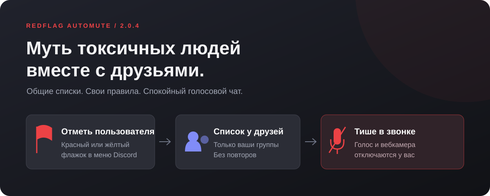
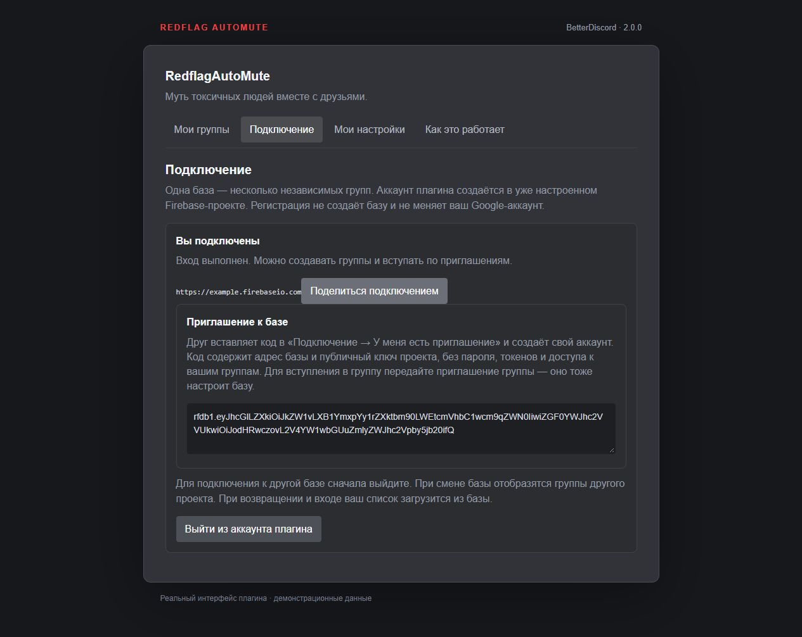
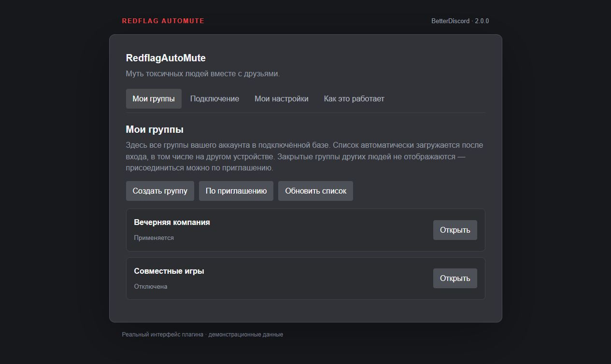

# 🚩 RedflagAutoMute

**Муть токсичных людей вместе с друзьями.**

Кто-то снова орёт в микрофон? Отметьте его один раз — друзья в вашей группе тоже перестанут его слышать. Общий список мьютов, отдельные компании и последнее слово всегда за вами.

  <a href="https://github.com/HilistonGit/Vencord_RedflagAutoMute/releases/download/v2.0.4/RedflagAutoMute-2.0.4.zip"><strong>⬇ Скачать для Windows · 2.0.4</strong></a>
  &nbsp; · &nbsp;
  <a href="#-начать-с-друзьями">Быстрый старт</a>
  &nbsp; · &nbsp;
  <a href="CHANGELOG.md">Что нового</a>

## ✨ Что умеет

- **Общие мьюты.** Флажки друзей автоматически приходят всем участникам группы.
- **Тише и спокойнее.** Плагин отключает голос и вебкамеру отмеченного человека только для вас.
- **Всё видно.** Красная рамка выделяет человека из списка, а отметка в заметке сохраняет ID записи и дату блокировки.
- **Ваши правила.** Разные группы для разных компаний и личные исключения, если вы не согласны с чужим решением.
- **Старые мьюты не пропадут зря.** Импортируйте сохранённый список Discord и объедините его со списками друзей без дублей.

Это личный фильтр общения: он не банит людей на сервере и не скрывает их текстовые сообщения.

## 🚀 Начать с друзьями

### 1. Установите

[Скачайте архив для Windows](https://github.com/HilistonGit/Vencord_RedflagAutoMute/releases/download/v2.0.4/RedflagAutoMute-2.0.4.zip), **полностью распакуйте** его и запустите `Install.cmd`.

Выберите **1 — Установить / восстановить + включить автовосстановление** и дождитесь завершения. Установщик поставит BetterDiscord и плагин. Если попросит закрыть Discord — закройте его и в трее.

> Уже установлен Vencord? Сначала перейдите на [BetterDiscord](https://betterdiscord.app/): установщик не заменяет другую модификацию автоматически.

### 2. Откройте плагин

В Discord: **Настройки → BetterDiscord → Плагины → RedflagAutoMute**.

Включите переключатель и нажмите шестерёнку рядом.

### 3. Вставьте приглашение

Откройте **Подключение → У меня есть приглашение**, вставьте код друга и нажмите **Продолжить**.

Появится форма входа. В первый раз выберите **Нет аккаунта? Создать**, укажите email и придумайте **отдельный пароль**. Пароль Discord или Google не нужен.

**Готово!** Если это приглашение в группу, после входа вы вступите в неё автоматически. Создавать базу или поднимать сервер другу не нужно.

👀 Как выглядит экран подключения

*Демонстрация интерфейса с вымышленными данными. В Discord оформление зависит от вашей темы.*

## 🚩 Как пользоваться флажками

Нажмите **правой кнопкой по человеку → Redflag → выберите группу → флажок**.

- 🔴 **Один красный** — голос и вебкамера отключаются.
- 🟡 **Один жёлтый** — предупреждение. **Два жёлтых от разных участников одной группы** — мут.
- 🤝 **Не согласны?** Добавьте человека в личное «всегда разрешать» — для вас он останется слышен.

Свой флажок можно отозвать. Изменения приходят автоматически; вручную обновлять список не нужно.

## 👥 Одна компания — одна группа

Группа — ваш общий список внутри подключённой базы. Например, можно держать отдельно «Друзья» и «Вечерние игры».

**Работают только группы, в которые вы вступили и которые включили.** Чужие группы на вас не влияют. Жёлтые флажки из разных групп не складываются.

В разделе **Мои группы** можно создать группу, открыть её список, пригласить друзей, отключить её для себя или выйти. Владелец также может удалить группу для всех — с подтверждением.

**Пригласить друга:** Мои группы → Открыть → Пригласить друга. Передайте полученный код лично: он позволяет вступить в группу и выдавать флажки.

👀 Как выглядит список групп

*Демонстрация с вымышленными данными.*

## 📦 Уже есть много мьютов?

Откройте нужную группу → **Импорт / экспорт**.

1. Нажмите **Выгрузить мои мьюты Discord**. При желании добавьте пользователей с громкостью 0% и заблокированные аккаунты.
2. Скопируйте полученный список в поле импорта ниже (или сохраните JSON и загрузите его). Нажмите **Проверить список** → **Подтвердить импорт красных флажков**.
3. Для передачи списка файлом используйте **Сохранить JSON-файл**. Друг сможет загрузить его в том же разделе.

Ваш список `А, Б` и список друга `Б, В` объединятся в **А, Б, В**. Импортированные красные флажки действуют для всей выбранной группы.

> Импорт получает то, что ещё сохранено в вашем Discord. Старые мьюты, которые Discord уже потерял, восстановить не получится.

## 💬 Частые вопросы

**Я первый в компании. Где взять приглашение?**

Один человек один раз настраивает общую базу Firebase, создаёт группу и приглашает остальных. Свой сервер не нужен. [Пошаговая настройка базы →](docs/REFERENCE.md#firebase-один-раз-для-всей-компании)

**Регистрация создаёт мне новую базу?**

Нет. Она создаёт ваш аккаунт плагина в базе, к которой вы подключились по приглашению.

**А на другом компьютере?**

Подключитесь к той же базе и войдите в тот же аккаунт плагина — ваши группы загрузятся сами.

**Обновления нужно скачивать вручную?**

При установке через пункт **1** включаются фоновые обновления плагина и восстановление BetterDiscord. Новые версии плагина проверяются раз в 6 часов. Если для восстановления потребуется перезапуск Discord, появится предупреждение с возможностью отложить. [Настройки и диагностика →](docs/WINDOWS.md)

**Есть ограничения?**

До **5 своих групп** на аккаунт и до **5000 пользователей с флажками** в каждой группе.

**Что нельзя пересылать друзьям?**

Не передавайте файл `RedflagAutoMute.config.json`: он содержит токены входа без шифрования. Для подключения делитесь приглашением, а для переноса мьютов — экспортированным списком.

🍎 🐧 Установка вручную, macOS и Linux

Установите [BetterDiscord](https://betterdiscord.app/), скачайте `RedflagAutoMute.plugin.js` из [релиза](https://github.com/HilistonGit/Vencord_RedflagAutoMute/releases/tag/v2.0.4) и поместите его в папку **Плагины → Open Plugins Folder**. Затем включите плагин и вставьте приглашение.

Автоматический установщик предназначен для Windows. Работа на macOS и Linux отдельно не проверялась.

---

[📖 Подробный справочник](docs/REFERENCE.md) · [🛠 Установка и диагностика Windows](docs/WINDOWS.md) · [📝 История изменений](CHANGELOG.md) · [🐛 Сообщить об ошибке](https://github.com/HilistonGit/Vencord_RedflagAutoMute/issues)

*Название репозитория осталось от старого прототипа. Текущая версия работает на BetterDiscord.*
